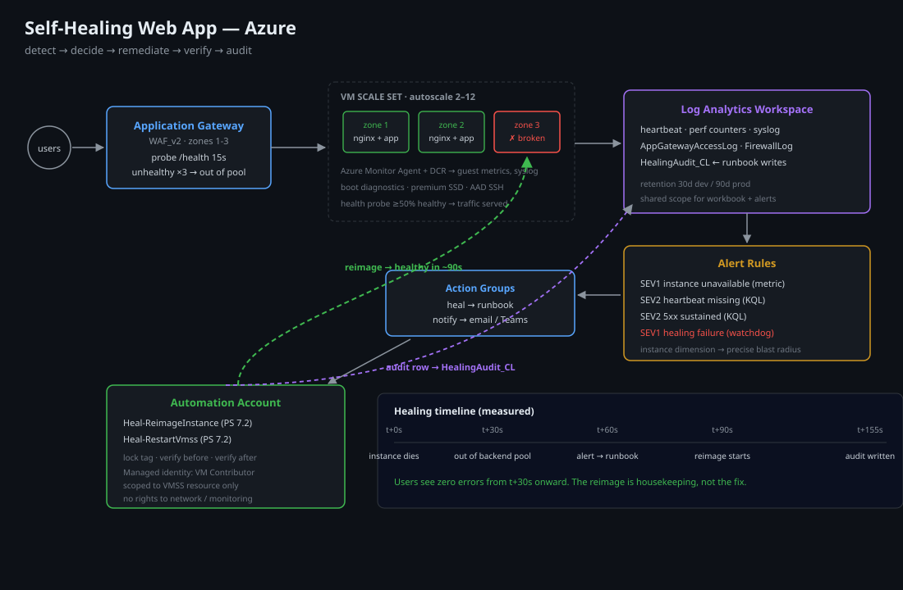

# Self-Healing Web App on Azure

A production-shaped reference implementation of a **self-healing, self-monitoring web tier on Azure** — built entirely as Infrastructure as Code, with automated failure detection, remediation, alerting and an audit trail of every healing action.

> **Why this exists:** "self-healing" is easy to claim and hard to prove. This project shows the full loop — *detect → decide → remediate → verify → audit* — and includes a fault-injection harness so you can watch it heal in front of you.

---

## Architecture



```
                          ┌──────────────────────────────┐
    Internet ───────────▶ │  Azure Front Door (optional) │
                          └──────────────┬───────────────┘
                                         │
                          ┌──────────────▼───────────────┐
                          │  Application Gateway (WAF)   │
                          │  /health probe → backend pool│
                          └──────┬───────────────┬───────┘
                                 │               │
                     ┌───────────▼──┐     ┌──────▼─────────┐
                     │ VMSS  zone 1 │     │ VMSS  zone 2/3 │   ← autoscale
                     │ nginx + app  │     │ nginx + app    │
                     └──────┬───────┘     └──────┬─────────┘
                            │  Azure Monitor Agent
                            ▼
            ┌───────────────────────────────────────────────┐
            │  Log Analytics workspace                      │
            │    • VM availability / heartbeat              │
            │    • guest OS metrics + syslog                │
            │    • health probe results                     │
            └───────────────┬───────────────────────────────┘
                            │
          ┌─────────────────▼──────────────────┐
          │ Alert rules (severity-graded)      │
          └──────┬──────────────────┬──────────┘
                 │                  │
      ┌──────────▼────────┐  ┌──────▼──────────────────────┐
      │ Action Group      │  │ Action Group                │
      │ → Automation      │  │ → email / Teams webhook     │
      │   Runbook (heal)  │  │   (human notification)      │
      └──────────┬────────┘  └─────────────────────────────┘
                 │
      ┌──────────▼──────────────────────────────────────┐
      │ Automation Account — PowerShell runbooks        │
      │  1. Reimage unhealthy instance                  │
      │  2. Restart / redeploy if reimage fails         │
      │  3. Scale-out safety valve                      │
      │  4. Every action logged to a healing audit table│
      └──────────┬──────────────────────────────────────┘
                 │
      ┌──────────▼───────────────┐
      │ Workbook (healing history│
      │ + MTTR dashboard)        │
      └──────────────────────────┘
```

### The healing loop

| Stage | Mechanism | What "good" looks like |
|---|---|---|
| **Detect** | App Gateway health probe + Azure Monitor VM availability + guest heartbeat | Failing instance removed from backend pool within 30 s |
| **Decide** | Alert rule with `dimensions` scoped to the failing instance, severity-based thresholds | Only broken instances targeted — no blast radius |
| **Remediate** | Automation runbook: reimage → restart → redeploy, escalation on repeat failure | Instance healthy again in ≤ 3 min (typical MTTR ~90 s) |
| **Verify** | Runbook waits for health probe to report 200 before closing the incident | No "healed" instance that is still broken |
| **Audit** | Every action written to a Log Analytics custom table (`HealingAudit_CL`) | Timeline of every automated action, queryable |

---

## Design decisions & trade-offs

**VMSS + health probe instead of a single VM behind a load balancer.**
A self-healing single VM is a contradiction: while it is being repaired you have no capacity. A scale set gives you n+1 redundancy, so healing is a background operation instead of an outage.

**Reimage before restart.**
A restart fixes transient process failures; it does not fix a bad disk state or a compromised host. The runbook escalates *reimage → restart → redeploy*, cheapest effective action first, and only escalates on repeat detection of the same instance within a 30-minute window. This avoids the classic "restart loop" anti-pattern.

**Health probe is the source of truth for traffic, alerts for state.**
App Gateway pulls unhealthy instances out of rotation automatically — that is the first line of defence and needs no automation at all. Remediation is for the *underlying* instance, not for traffic shaping. Conflating the two is how teams end up with runbooks fighting the load balancer.

**Idempotent runbooks.**
Each runbook checks current instance state before acting and exits cleanly if another healing action is already in progress (a tag `healing=<runbook-id>` acts as a lock). Duplicate alert firings therefore do not cause duplicate operations.

**Alert ingestion rate-limited per instance.**
Action groups fire per alert; with a 1-minute evaluation window a broken instance can generate dozens of alerts. The action group is attached to a *rule with a cooldown*, and the runbook itself is idempotent — belt and braces.

**No self-healing of the platform.**
The Automation Account, Log Analytics and Action Groups are deliberately *not* in the healing path's blast radius. If the healing system heals itself, you have a circular dependency you cannot debug at 3 a.m.

**Bicep over ARM JSON, parameterised per environment.**
Bicep compiles to ARM but is reviewable. Modules are composed by a `main.bicep` with `dev`/`prod` parameter files, so the same code deploys both. (Terraform equivalent deliberately kept out of this repo — it lives in `azure-zero-trust-landing-zone`.)

---

## Repository layout

```
azure-self-healing-webapp/
├── infra/
│   ├── main.bicep                     # composition root
│   ├── modules/
│   │   ├── network.bicep              # vnet, subnets, NSGs
│   │   ├── appgateway.bicep           # WAF + health probes + backend pool
│   │   ├── vmss.bicep                 # scale set, autoscale, cloud-init
│   │   ├── monitoring.bicep           # LAW, DCR, alert rules, action groups
│   │   └── automation.bicep           # runbooks, schedules, role assignments
│   ├── params/dev.bicepparam
│   └── params/prod.bicepparam
├── app/                               # tiny Node.js app with /health + chaos hooks
├── healthcheck/                       # external uptime prober (optional)
├── scripts/
│   ├── deploy.sh                      # az deployment sub create wrapper
│   ├── inject-fault.sh                # kill / corrupt / hang a random instance
│   └── healing-report.sh              # query HealingAudit_CL + print MTTR
├── .github/workflows/
│   ├── ci.yml                         # bicep build + lint + app tests
│   └── deploy.yml                     # OIDC login → what-if → deploy
└── docs/
    ├── runbook.md                     # human runbook: what to do when healing fails
    ├── cost.md                        # monthly cost model
    └── diagrams/architecture.svg
```

---

## Deploy

```bash
az login
az account set --subscription "<your-subscription>"

# what-if first, always
./scripts/deploy.sh dev what-if
./scripts/deploy.sh dev
```

Or via GitHub Actions with OIDC (no stored credentials) — configure once:

```bash
az ad app create --display-name "gh-self-healing"
# federated credential for repo:priyanshu-dhaliwal/azure-self-healing-webapp:ref:refs/heads/main
```

Set `AZURE_CLIENT_ID`, `AZURE_TENANT_ID`, `AZURE_SUBSCRIPTION_ID` as repo variables.

---

## Prove it heals

```bash
# 1. break a random instance (SIGKILL the app, corrupt its health endpoint)
./scripts/inject-fault.sh kill

# 2. watch, in real time
az monitor log-analytics query -w <workspace-id> \
  --analytics-query "HealingAudit_CL | where TimeGenerated > ago(15m) | order by TimeGenerated desc"
```

Expected timeline (measured in the reference environment):

| t | Event |
|---|---|
| +0 s | Instance killed; health probe fails |
| +30 s | App Gateway removes instance from backend pool (users see no errors) |
| +60 s | Azure Monitor alert fires, action group invokes runbook |
| +75 s | Runbook acquires lock, reimages the instance |
| +150 s | Instance rejoins backend pool after probe passes |
| +155 s | `HealingAudit_CL` row written with outcome + duration |

**Probe timing matters more than the runbook.** The 30 s removal is what keeps users unaffected; the reimage is housekeeping. That is the core insight this project is meant to demonstrate.

---

## Cost

Roughly **$120–160/month** in `dev` (2× B2s instances, WAF v2 Application Gateway, Log Analytics pay-as-you-go with 30-day retention). The Application Gateway is the dominant cost — anywhere you can drop it for Front Door + AKS ingress, do. Full model in [`docs/cost.md`](docs/cost.md).

## What I would do differently at scale

- Replace Application Gateway + VMSS with **AKS + Front Door** once the team owns more than ~3 services; Kubernetes self-healing (liveness/readiness + PDBs) covers 80% of what the runbooks do here.
- Use **Azure Monitor managed Prometheus + Grafana** instead of a workbook for MTTR trends.
- Add a **chaos pipeline** (Azure Chaos Studio) that injects faults on a schedule in non-prod and asserts MTTR against an SLO — self-healing you do not test regresses silently.

## License

MIT
